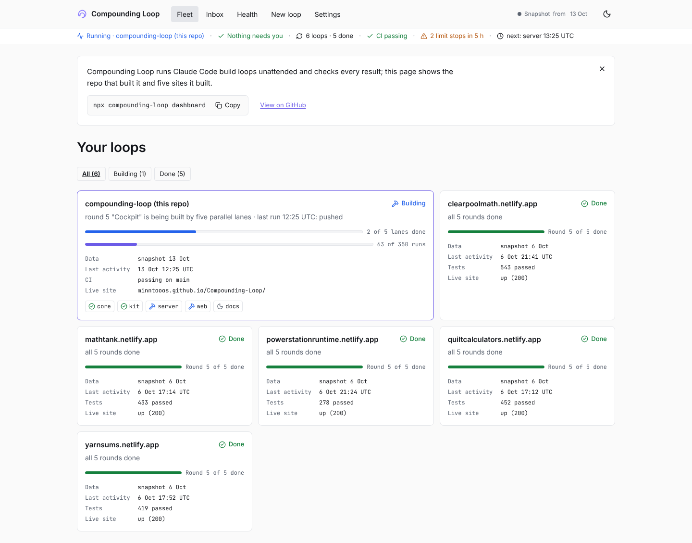

# Dashboard tour

```sh
npx compounding-loop dashboard            # your projects
npx compounding-loop dashboard --demo     # five real builds, read-only
```

It serves on loopback only. Options: `--port N`, `--no-open`, `--projects dir`.

- **Fleet:** every loop with its state (running, needs you, done, failing), round, tests and last commit.
- **Loop detail:** tabs for the timeline, contract, knowledge, decisions and settings.
- **Inbox:** questions from `BLOCKED.md`. Keyboard: `j`/`k` to move, `a` to accept the suggested answer.
- **Health:** checks such as stale locks, a loop with no commit for two hours, or runs that end in seconds.
- **New loop wizard:** scores your brief live, picks a template and runner, and shows the exact command.
- **Lanes:** each lane's state, run N/LIMIT, last commit and any active claim by a teammate ([team workflow](team.md)).
- **Live demo:** the [hosted demo](https://minntooos.github.io/Compounding-Loop/) reads this repo's commits from GitHub in your browser. If GitHub's 60 requests per hour limit is hit, it falls back to a bundled snapshot; the header chip says Live or Snapshot.
- **Settings:** light and dark theme.



Regenerate the screenshots with `npm run build && SCREENS=1 npx playwright test screenshots`.
